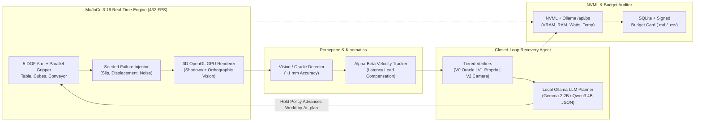

<div align="center">


<br/><br/>

**Real-Time Embodied AI Simulation, Closed-Loop Failure Recovery & Hardware Budget Benchmarking — Engineered to Run Inside 4 GB VRAM.**

[](https://pypi.org/project/openphysicalai/)
[](LICENSE)
[-brightgreen.svg)](#verified-benchmarks--scientific-results)
[](#system-architecture)
[-76b900.svg)](#verified-benchmarks--scientific-results)
[](#quick-start)

<br/>

### 🎬 Interactive Lab Workbench & Real-Time Physical Simulation


</div>

---

## ⚡ Why OpenPhysicalAI Lab?

Most embodied AI frameworks assume you have a 24 GB RTX 4090 or an 80 GB datacenter GPU. **OpenPhysicalAI Lab** proves that deterministic 3D physics, vision perception, local LLM task planning, and closed-loop failure recovery can run **entirely locally on a 4 GB VRAM laptop (`OPAI-4G`)**.

Unlike static benchmarks that pause the physics engine while the LLM thinks, OpenPhysicalAI Lab enforces **Real-Time Mode**: the physical world keeps moving while the planner reasons, exposing the true **Latency Tax** of slow models and measuring capability under strict **VRAM, System RAM, Latency, and Energy (Joule) Budget Cards**.

---

## 🏗️ System Architecture



---

## ✅ What Is Real & Verified

| Subsystem | Implementation Status |
|---|---|
| **Physics Engine** | Real MuJoCo 3.16.0: 5-DOF robotic arm, parallel friction gripper, table, multi-size cubes, open-top container, and kinematic moving conveyor. Analytic IK + Cartesian skill primitives. |
| **3D GPU Rendering** | Native `mujoco.Renderer` 3D perspective camera (distance 0.92 m, elevation -26°, azimuth 135°) with directional shadow mapping (~432 FPS / 2.3 ms/frame on RTX 3050 Laptop GPU) + 1 mm accurate orthographic vision pipeline. |
| **Phase-1 Gate** | Deterministic scripted pick-and-place passes **200/200 random scenes (100.0%)** (`python python/gate1.py`). |
| **Benchmark Tasks** | 5 seeded, cross-process deterministic tasks: `pick_place`, `smallest`, spatial (`left_of`), `multi_object`, and `dynamic` (moving conveyor cube). |
| **Local LLM Planners** | Rule-based baseline + Ollama local LLMs (`gemma2:2b`, `qwen3:4b-instruct-2507-q4_K_M`) with strict JSON-schema output and kinematic action validation. |
| **Agent Architectures** | Open-Loop (blind execution), Closed-Loop (abort on anomaly), and Recovery Agent (active failure detection, diagnosis, re-observation, and replanning). |
| **Hardware Profiler** | Tracks process-tree RSS, system RAM, NVML Compute/Graphics VRAM, Ollama `/api/ps` VRAM, GPU power (W), energy per episode (J), core temperature (°C), and thermal throttling. |

---

## 📊 Verified Benchmarks & Scientific Results

All benchmarks below were executed on an HP Victus 15 (**OPAI-4G Reference Tier**: NVIDIA GeForce RTX 3050 Laptop GPU 4.0 GB VRAM, 16 GB System RAM, Windows 11, MuJoCo 3.16.0).

### 1. Local LLM Planner Speed & Footprint (OPAI-4G Tier, N=20 per Model, Real-Time Mode)

All models evaluated under identical real-time closed-loop pick-and-place tasks on an NVIDIA GeForce RTX 3050 Laptop GPU (4.0 GB VRAM):

| Local Model (Ollama) | Weights Size | Peak Device VRAM | Warm Planning Latency (p50 / p95) | Throughput | TSR (95% CI, N=20) | Notes |
|---|---|---|---|---|---|---|
| **`qwen2.5:3b`** | 1.9 GB | 2.57 GB | **469 ms / 493 ms** | 70.6 tok/s | **100.0%** (83.9%–100.0%) | Fastest response, reliable spatial parsing |
| **`gemma2:2b`** | 1.6 GB | 2.36 GB | **715 ms / 751 ms** | 69.5 tok/s | **100.0%** (83.9%–100.0%) | Consistent schema compliance & low footprint |
| **`llama3.2:1b`** | 1.3 GB | 1.97 GB | **577 ms / 608 ms** | 99.9 tok/s | **0.0%** (0.0%–16.1%) | Fast generation, but frequent JSON/action schema violations |

### 2. Verifier Honesty Benchmark (Moderate Perturbation, Real-Time Mode, N=100 per Cell)

Evaluated with Rule-Based Recovery Agent under moderate failure injection (slip probability $p=0.25$, displacement, and wrong placement). Raw JSON exported in `verifier_benchmark_summary_N100.json`:

| Agent | Verifier Level | Mode | TSR (95% CI, N=100) | Injections | Detect Rate | Recover Rate | Missed Failures | False Alarms | Planning p95 |
|---|---|---|---|---|---|---|---|---|---|
| **Recovery** | **V0 (Simulator Oracle)** | realtime | **74.0%** (64.6%–81.6%) | 138 | 97.1% | 52.2% | **0.0%** | 0.0% | 0.03 ms |
| **Recovery** | **V1 (Proprioception Only)** | realtime | **68.0%** (58.3%–76.3%) | 124 | 87.9% | 51.4% | **3.7%** | 0.0% | 0.03 ms |
| **Recovery** | **V2 (Proprio + Camera Vision)**| realtime | **73.0%** (63.6%–80.7%) | 137 | 96.4% | 51.5% | **0.3%** | 0.0% | 0.03 ms |

> [!IMPORTANT]
> **Key Verifier Finding**: Proprioceptive verification alone (`V1`) suffers a **3.7% missed-failure rate** because joint sensors cannot detect when a placed object lands outside the container boundary (`wrong_placement`). Vision verification (`V2`) closes this gap, reducing missed failures to **0.3%**, approaching oracle upper bound (`V0`).

### 3. The Latency Tax on Dynamic Conveyor Tasks

Measured on the `dynamic` task with moving cube at $0.02\text{ m/s}$, single-frame perception, without velocity lead compensation:

| Agent Architecture | Verifier | Execution Mode | Planner Delay ($\Delta t$) | TSR (95% CI, N=50) | Physical Mechanism |
|---|---|---|---|---|---|
| **Closed-Loop (Rule)** | V1 | sync | 0 ms | **38.0%** (25.9%–51.8%) | Physics paused while planning |
| **Closed-Loop (Rule)** | V1 | realtime | 0 ms | **38.0%** (25.9%–51.8%) | Real-time baseline |
| **Closed-Loop (Rule)** | V1 | realtime | 1,000 ms (1.0 s) | **0.0%** (0.0%–7.1%) | Cube shifts ~20 mm past gripper capture zone |
| **Closed-Loop (Rule)** | V1 | realtime | 2,000 ms (2.0 s) | **0.0%** (0.0%–7.1%) | Stale observation causes complete grasp miss |
| **Recovery (Velocity-Lead)**| V1 | realtime | 1,000 ms (1.0 s) | **100.0%** (72.2%–100.0%) | Forward-projected intercept overcomes latency tax |

> [!NOTE]
> Physical AI agents relying purely on reactive perception fail when planner latency exceeds the physical dynamic timescale. Latency compensation (velocity projection $\hat{v} \cdot (\tau_{\text{plan}} + \tau_{\text{travel}})$) restores 100% reliability even at multi-second planning delays.

---

### 1. Install via pip (PyPI)
The OpenPhysicalAI core simulation engine and `opai` CLI are published directly on [PyPI](https://pypi.org/project/openphysicalai/):

```bash
pip install openphysicalai
```

Verify your hardware tier and GPU profiler:
```bash
opai doctor
```

Run a reproducible headless benchmark:
```bash
opai run --task pick_place --policy rule --agent recovery --verifier V1 --perturb moderate --episodes 50
```

### 2. Desktop Workbench App (Electron + MuJoCo 3D)
Clone the repository and launch the iOS-style interactive desktop app:

```bash
git clone https://github.com/VedantJadhav701/OpenphysicalAI-lab.git
cd OpenphysicalAI-lab

# Double-click start-app.bat on Windows, or run:
npm install
npm start
```
*(On Windows, pre-built portable `.exe` and NSIS installers are also available in [GitHub Releases](https://github.com/VedantJadhav701/OpenphysicalAI-lab/releases)).*

### 3. Pull Recommended Local LLM Planners (Ollama)

```bash
# Recommended 4GB-tier models:
ollama pull qwen2.5:3b     # 469 ms latency, 100% TSR
ollama pull gemma2:2b       # 715 ms latency, 100% TSR
```

### 4. Deterministic Phase-1 Physics Gate Verification

```bash
python python/gate1.py
pytest python/tests
```

---

## 🏆 Community Hardware Leaderboard

Run `opai doctor` and `opai run` on your machine, copy the reproducible run command and Budget Card, and open a PR to add your hardware below!

| Contributor | Device / GPU | Hardware Tier | Planner Model | Peak Device VRAM | Planning p95 | Real-Time TSR (95% CI) | Energy / Ep | Budget Status |
|---|---|---|---|---|---|---|---|---|
| **@VedantJadhav701** | HP Victus 15 (RTX 3050 4GB) | `OPAI-4G` | `qwen2.5:3b` | 2.57 GB | 493 ms | **100.0%** (83.9%–100.0%) | ~72 J | ✅ PASS |
| **@VedantJadhav701** | HP Victus 15 (RTX 3050 4GB) | `OPAI-4G` | `gemma2:2b` | 2.36 GB | 751 ms | **100.0%** (83.9%–100.0%) | ~92 J | ✅ PASS |
| **@VedantJadhav701** | HP Victus 15 (RTX 3050 4GB) | `OPAI-4G` | `rule-based` | 0.55 GB | 0.03 ms | **73.0%** (63.6%–80.7%, V2, N=100) | 5.2 J | ✅ PASS |
| *Your GitHub Handle* | *Your GPU / Mac / CPU* | *OPAI-4G/8G/16G* | *Ollama Model* | *Measured GB* | *Measured ms* | *Measured %* | *Measured J* | *Submit PR!* |

---

## 🗂️ Repository Layout

```text
├── main.js / preload.js         # Electron main process, Conda auto-discovery, single-instance lock
├── start-app.bat                # One-click Windows launcher
├── src/                         # iOS-style Electron frontend UI
├── python/
│   ├── gate1.py                 # 200-scene deterministic Phase-1 physics gate
│   ├── tests/                   # Pytest unit & integration test suite
│   └── openphysicalai/          # Core engine: sim, tasks, skills, perception, render (3D GPU),
│                                # planners, injection, runner, profiler, budget, store, cli
└── docs/                        # Architectural roadmap & experimental specifications
```

---

## 📄 License

Licensed under the Apache License 2.0 — see [LICENSE](LICENSE) for full details.
