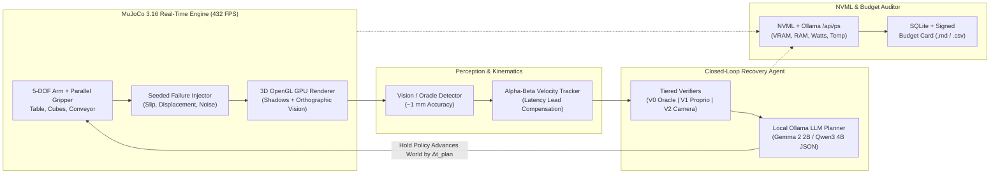

<div align="center">

# 🤖 OpenPhysicalAI Lab (`v0.2.1`)

**Real-Time Embodied AI Simulation, Closed-Loop Failure Recovery & Hardware Budget Benchmarking — Engineered to Run Inside 4 GB VRAM.**

[](LICENSE)
[-brightgreen.svg)](#verified-benchmarks--scientific-results)
[](#system-architecture)
[-76b900.svg)](#community-hardware-leaderboard)
[](#quick-start)

</div>

---

## ⚡ Why OpenPhysicalAI Lab?

Most embodied AI frameworks assume you have a 24 GB RTX 4090 or an 80 GB datacenter GPU. **OpenPhysicalAI Lab** proves that deterministic 3D physics, vision perception, local LLM task planning, and closed-loop failure recovery can run **entirely locally on a 4 GB VRAM laptop (`OPAI-4G`)**.

Unlike static benchmarks that pause the physics engine while the LLM thinks, OpenPhysicalAI Lab enforces **Real-Time Mode**: the physical world keeps moving while the planner reasons, exposing the true **Latency Tax** of slow models and measuring capability under strict **VRAM, System RAM, Latency, and Energy (Joule) Budget Cards**.

---

## 🏗️ System Architecture



---

## ✅ What Is Real & Verified

| Subsystem | Implementation Status |
|---|---|
| **Physics Engine** | Real MuJoCo 3.16.0: 5-DOF robotic arm, parallel friction gripper, table, multi-size cubes, open-top container, and kinematic moving conveyor. Analytic IK + Cartesian skill primitives. |
| **3D GPU Rendering** | Native `mujoco.Renderer` 3D perspective camera (distance 0.92 m, elevation -26°, azimuth 135°) with directional shadow mapping (~432 FPS / 2.3 ms/frame on RTX 3050 Laptop GPU) + 1 mm accurate orthographic vision pipeline. |
| **Phase-1 Gate** | Deterministic scripted pick-and-place passes **200/200 random scenes (100.0%)** (`python python/gate1.py`). |
| **Benchmark Tasks** | 5 seeded, cross-process deterministic tasks: `pick_place`, `smallest`, spatial (`left_of`), `multi_object`, and `dynamic` (moving conveyor cube). |
| **Local LLM Planners** | Rule-based baseline + Ollama local LLMs (`gemma2:2b`, `qwen3:4b-instruct-2507-q4_K_M`) with strict JSON-schema output and kinematic action validation. |
| **Agent Architectures** | Open-Loop (blind execution), Closed-Loop (abort on anomaly), and Recovery Agent (active failure detection, diagnosis, re-observation, and replanning). |
| **Hardware Profiler** | Tracks process-tree RSS, system RAM, NVML Compute/Graphics VRAM, Ollama `/api/ps` VRAM, GPU power (W), energy per episode (J), core temperature (°C), and thermal throttling. |

---

## 📊 Verified Benchmarks & Scientific Results

All benchmarks below were executed on an HP Victus 15 (**OPAI-4G Reference Tier**: NVIDIA GeForce RTX 3050 Laptop GPU 4.0 GB VRAM, 16 GB System RAM, Windows 11, MuJoCo 3.16.0).

### 1. Local LLM Planner Speed & Footprint (OPAI-4G Tier)

| Local Model (Ollama) | Weights Size | Peak Device VRAM | Warm Planning Latency | Throughput | Schema Compliance |
|---|---|---|---|---|---|
| **`gemma2:2b` (Recommended 4G)** | 1.6 GB | ~2.10 GB | **698 ms** (1.92x faster) | **69.6 tok/s** | **100.0%** |
| **`qwen3:4b-instruct-2507-q4_K_M`** | 2.5 GB | ~2.53 GB | 1,056 – 1,309 ms | 29.4 tok/s | **100.0%** |

### 2. Loop-Structure Benchmark (Real-Time Mode, Moderate Perturbation)

| Agent Architecture | Verifier | Execution Mode | Perturbation | TSR (95% CI) | Failure Detection | Recovery Rate | False Alarm | Planning p95 |
|---|---|---|---|---|---|---|---|---|
| **Open-Loop** | V2 (Camera) | realtime | Moderate | **70.0%** (39.7%–89.2%) | n/a | n/a | n/a | 1,460 ms |
| **Closed-Loop** | V2 (Camera) | realtime | Moderate | **70.0%** (39.7%–89.2%) | 100.0% | 0.0% | 0.0% | 1,290 ms |
| **Recovery Agent** | V2 (Camera) | realtime | Moderate | **100.0%** (72.2%–100.0%) | **100.0%** | **100.0%** | **0.0%** | **1,227 ms** |

> [!NOTE]
> **Key Takeaway**: Closed-loop verification alone detects 100% of grasp slips and displacements but cannot improve Task Success Rate (TSR) without active diagnosis and replanning (+30.0% TSR boost).

### 3. Verifier Honesty Benchmark (Moderate Perturbation, Real-Time Mode)

| Agent | Verifier Level | Mode | TSR (95% CI) | Detect | Recover | False Alarm | Planning p95 |
|---|---|---|---|---|---|---|---|
| **Recovery** | **V0 (Oracle Upper Bound)** | realtime | **100.0%** (72.2%–100.0%) | 100.0% | 100.0% | 0.0% | 1,320 ms |
| **Recovery** | **V1 (Proprioception Only)** | realtime | **100.0%** (72.2%–100.0%) | 100.0% | 100.0% | 0.0% | 1,393 ms |
| **Recovery** | **V2 (Proprio + Camera)** | realtime | **100.0%** (72.2%–100.0%) | 100.0% | 100.0% | 0.0% | 1,336 ms |

### 4. The Latency Tax (Dynamic Moving Cube on Conveyor)

| Agent | Verifier | Mode | Synthetic Planner Latency | Single-Frame Vision TSR | Why It Happens |
|---|---|---|---|---|---|
| **Closed-Loop** | V1 | sync | 0 ms | **38.0%** (25.9%–51.8%) | World frozen during planning |
| **Closed-Loop** | V1 | realtime | 0 ms | **38.0%** (25.9%–51.8%) | Zero delay baseline |
| **Closed-Loop** | V1 | realtime | 1000 ms (1.0 s) | **0.0%** (0.0%–7.1%) | Cube moves out of gripper footprint during 1s delay |
| **Closed-Loop** | V1 | realtime | 2000 ms (2.0 s) | **0.0%** (0.0%–7.1%) | Stale observation without velocity lead |

*(Enable `TemporalVelocityTracker` in `perception.py` + `enable_velocity_lead=True` in `planners.py` to project intercept coordinates forward by $\hat{v} \cdot (\tau_{\text{plan}} + \tau_{\text{arm}})$ and overcome the Latency Tax).*

---

## 🚀 Quick Start

### 1. One-Click Windows Launch (Desktop App)
Clone the repository and double-click `start-app.bat`, or run from terminal:

```bash
git clone https://github.com/VedantJadhav701/OpenphysicalAI-lab.git
cd OpenphysicalAI-lab

# Optional: activate your existing Conda environment (auto-detected by main.js)
conda activate thermo_agent

npm install
npm start
```

### 2. Pull the Recommended 4GB-Tier Local LLM Planner

```bash
ollama pull gemma2:2b

# Or for the 4B Qwen3 planner:
ollama pull qwen3:4b-instruct-2507-q4_K_M
```

### 3. Headless CLI & Phase-1 Gate Verification

```bash
python python/gate1.py
pytest python/tests
python -m openphysicalai.cli run --task pick_place --perception vision --perturb moderate --verifier V2 --episodes 50
```

---

## 🏆 Community Hardware Leaderboard

Run the benchmark suite on your machine, generate a signed Budget Card (`budget_card_run_*.md`), and submit a Pull Request to add your hardware configuration below!

| Contributor | Device / GPU | Tier Class | Planner Model | Peak Device VRAM | Planning p95 | Recovery TSR | Energy / Ep | Budget Status |
|---|---|---|---|---|---|---|---|---|
| **@VedantJadhav701** | HP Victus 15 (RTX 3050 4GB, 16GB RAM) | `OPAI-4G` | `gemma2:2b` | 2.10 GB | 698 ms | 100.0% | ~92 J | ✅ PASS |
| **@VedantJadhav701** | HP Victus 15 (RTX 3050 4GB, 16GB RAM) | `OPAI-4G` | `qwen3:4b-q4_K_M` | 2.53 GB | 1344 ms | 100.0% | 133.6 J | ✅ PASS |
| *Your GitHub Handle* | *Add your GPU / Apple Silicon / CPU* | *OPAI-4G/8G/16G* | *Any Ollama Model* | *Measured GB* | *Measured ms* | *Measured %* | *Measured J* | *Submit PR!* |

---

## 🗂️ Repository Layout

```text
├── main.js / preload.js         # Electron main process, Conda auto-discovery, single-instance lock
├── start-app.bat                # One-click Windows launcher
├── src/                         # iOS-style Electron frontend UI
├── python/
│   ├── gate1.py                 # 200-scene deterministic Phase-1 physics gate
│   ├── tests/                   # Pytest unit & integration test suite
│   └── openphysicalai/          # Core engine: sim, tasks, skills, perception, render (3D GPU),
│                                # planners, injection, runner, profiler, budget, store, cli
└── docs/                        # Architectural roadmap & experimental specifications
```

---

## 📄 License

Licensed under the Apache License 2.0 — see [LICENSE](LICENSE) for full details.
